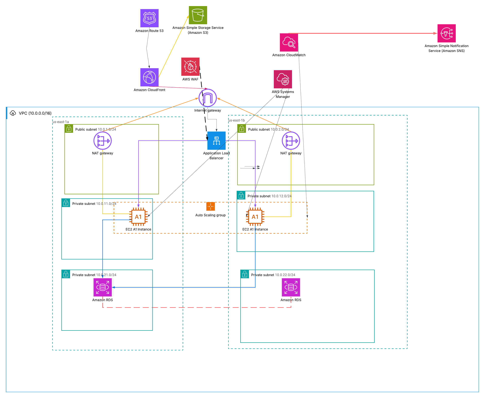

# Scalable Web Application on AWS (ALB + Auto Scaling)

Highly available, production-grade web application deployed on AWS using EC2 instances in a multi-AZ VPC, with ALB, Auto Scaling, RDS Multi-AZ, CloudFront and WAF.

## Architecture

**Request flow:** Route 53 → CloudFront → ALB (protected by WAF) → EC2 instances (Auto Scaling Group, private subnets) → RDS Multi-AZ.

## AWS Services Used

| Service | Role in the project |
|---|---|
| VPC | 2 AZs, public + private subnets, route tables, Internet Gateway, NAT Gateways |
| EC2 + Auto Scaling | Launch Template, target tracking policy (CPU 50%) |
| ALB + WAF | Layer 7 load balancing, OWASP Top 10 managed rules |
| CloudFront + S3 | Caching of static assets |
| RDS Multi-AZ | MySQL/PostgreSQL with automatic failover |
| Route 53 | Alias record to the ALB, health checks |
| Systems Manager | Session Manager (no bastion, no open SSH port) |
| CloudWatch + SNS | Dashboard, alarms, notifications |

## Network Design

- VPC CIDR: 10.0.0.0/16
- Public subnets: 10.0.1.0/24 (AZ a), 10.0.2.0/24 (AZ b)
- Private app subnets: 10.0.11.0/24, 10.0.12.0/24
- Private DB subnets: 10.0.21.0/24, 10.0.22.0/24
- Route tables: public → Internet Gateway, private → NAT Gateway

## Security

- Security Groups: ALB ← Internet (80/443), EC2 ← ALB only, RDS ← EC2 only
- NACLs: (describe your rules)
- All compute and database in private subnets
- Access to instances through Session Manager only

## Deployment Steps

1. VPC, subnets, route tables, IGW, NAT
2. Security Groups
3. RDS Multi-AZ
4. Launch Template + Auto Scaling Group
5. ALB + Target Group
6. CloudFront + WAF
7. CloudWatch + SNS

(Add a screenshot after each step.)

## Tests and Results

- Auto Scaling: scale out under load (screenshot)
- Self-healing: terminated instance replaced (screenshot)
- RDS failover: reboot with failover (screenshot)
- Session Manager connection (screenshot)

## Challenges and Solutions

(Problems you hit and how you fixed them.)

## AWS Academy Learner Lab Limitations

(Services that were blocked or limited, and how you handled them.)

## Demo

(Link to live URL or video.)

## Cleanup

(Resources deleted after the demo.)
